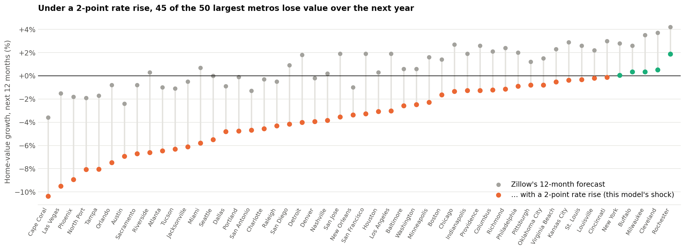
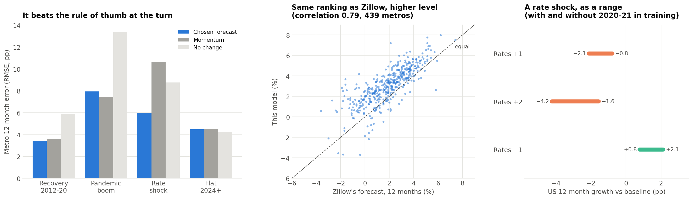

# Where Are US Home Values Heading, and What Would a Rate Shock Do?

[](https://github.com/janeruxi1/housing-hierarchical-forecast/actions)

[](https://janeruxi1-housing-hierarchical-forecast.streamlit.app/)

**[Decision memo](reports/decision_memo.md)** · **[Live demo](https://janeruxi1-housing-hierarchical-forecast.streamlit.app/)** · **[Full results](docs/results.md)** · **[Model card](MODEL_CARD.md)** · **[Phase by phase](docs/PHASES.md)**

A mortgage lender, mortgage insurer or home-buying investor sets limits by state and by metro, and needs
to know where home values are heading over the next year and how hard a rise in mortgage rates would hit
each place. This project forecasts home values 1 to 12 months ahead for the nation, 49 states and 605 metro
groups, built up from 1,371 counties (84% of US homes) so that every level adds up, then stress-tests the
forecast. Data: Zillow's home value index through September 2026, Census housing units, FRED rates. CI
checks every number below against the recorded results.

## Key results

- **It beats the rule of thumb where it matters.** "The last 12 months' growth continues" (momentum) is the
  usual shortcut. Over 47 quarterly forecast dates, 2014-2025, the chosen forecast's metro 12-month error is
  14% below momentum, and in the 2022-23 rate shock it falls from 10.6 to 6.0 pp, 44% lower.
- **A rate rise is the main 12-month risk, and it is quoted as a range.** A sudden 1-point rise lowers
  national growth by 0.8 to 2.1 pp ($0.45 to $1.2 trillion of housing value). High-beta Sun Belt metros take
  about four times the hit of Rust Belt ones (Las Vegas -4.2 pp, Pittsburgh -1.0 pp).
- **Same ranking as Zillow, higher level.** This model expects 3.2% national growth against Zillow's 1.1%.
  The two rank metros alike (correlation 0.79 across 439 metros), so the memo budgets on Zillow's level and
  uses this model for ranking and stress: with a 2-point rise, 45 of the 50 largest metros lose value.
- **For a risk committee:** tighten limits in the ten most rate-sensitive large metros, plan on the 95%
  range (the 80% range covered only 73% of metro outcomes), and do not use the model for a recession.



*Grey: Zillow's own 12-month forecast for each of the 50 largest metros. Orange or green: the same forecast
after this model's 2-point rate shock for that metro, scaled by how hard it swings with the national cycle.
Drawn from the recorded results by `scripts/make_readme_figure.py`.*

## How it works

| Step | Method | Where |
|---|---|---|
| Make it add up | County panel balanced from 2008; housing-stock value (index x Census housing units) summed to metros, states and the nation; rebuilt series checked against Zillow's published ones | [01](notebooks/01_data_audit.ipynb) |
| Bar to beat | Rolling-origin backtest harness at 1/3/6/12 months; four no-model rules (no change, drift, momentum, long-run) | [02](notebooks/02_baselines_backtest.ipynb) |
| Models and reconciliation | Per-place ARIMA(2,1,0), a direct panel regression that reads mortgage rates and unemployment, a Zillow-style model and their combination; bottom-up vs three MinTrace variants; time-safe conformal ranges | [03](notebooks/03_models_reconciliation.ipynb) |
| Forecast and stress | Forecast from September 2026; comparison with Zillow's published forecast; rate and unemployment scenarios x each county's beta, added up | [04](notebooks/04_scenarios.ipynb) |
| Demo | Any state, metro or county, and the rate-shock sliders, on a derived extract that CI checks against the records | [`app/`](app/streamlit_app.py) |



*Left: metro 12-month error by period; the gain is at the 2022-23 turn, and no model saw the 2020-22 boom.
Middle: this model against Zillow's forecast for 439 metros. Right: the US rate shock with and without the
pandemic years in training, the range the memo quotes.*

## Data

[Zillow Research](https://www.zillow.com/research/data/) home value index (ZHVI, middle tier, smoothed and
seasonally adjusted) by county, metro, state and nation, and Zillow's forecast (ZHVF), used with
attribution; Census Population Estimates (Vintage 2025) for housing units; FRED for the 30-year mortgage rate,
unemployment and CPI. Raw files are not committed: `scripts/download_data.py` fetches them and records each
file's URL, date and SHA-256. The demo reads only derived results (growth rates, forecasts, scenario
responses), never Zillow's county series.

## Limits

- **The rate response leans on one episode.** Refitted without 2020-21 the 1-point shock falls from -2.1
  to -0.8 pp, so the memo quotes the range. A 2008-style recession is outside what the model can represent.
- **Ranges run narrow at turning points**, and Zillow restates its history, so the backtest uses today's
  series rather than what was known at each date.
- **The level is optimistic** against Zillow, which also sees listings, inventory and demand data.

<details>
<summary><b>Run it</b></summary>

```bash
pip install -r requirements.txt
pytest -q                                    # synthetic data, as CI does
python scripts/download_data.py              # real data: about 60 files, a few minutes
python scripts/build_data.py                 # data/processed/ and reports/metrics/data_audit.json
python scripts/run_models.py                 # model + reconciliation backtest, about 2 minutes
python scripts/build_notebooks.py --execute  # notebooks 01-04 on the real data
python scripts/build_app_data.py             # the demo's extract (app/data/)
pip install -r app/requirements.txt && streamlit run app/streamlit_app.py
```

</details>

<details>
<summary><b>Repository layout</b></summary>

```
reports/decision_memo.md, MODEL_CARD.md   the recommendation; what the model is and where it fails
reports/metrics/, reports/figures/        every number and figure, written by the notebooks
docs/results.md, docs/PHASES.md           full results; the project phase by phase
notebooks/01-04                           .py sources (run in CI) + executed .ipynb
src/housing/                              ingest, hierarchy, panel, backtest, models, reconcile, scenarios
app/                                      the demo and its derived extract (app/data/)
scripts/, tests/                          download, build, figures; pytest on synthetic data + record checks
data/                                     raw/ and processed/ (not committed); READMEs describe each file
```

</details>

**Related:** [NYC congestion toll](https://github.com/janeruxi1/nyc-congestion-toll-causal-impact) (another
forecast counterfactual) · [Driver pay pricing](https://github.com/janeruxi1/ridehail-driver-pay-optimization) ·
[All projects](https://github.com/janeruxi1)
