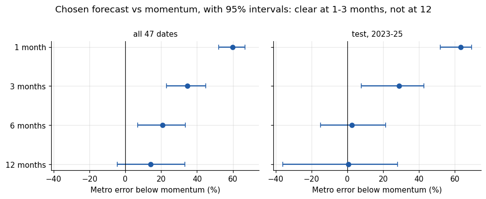
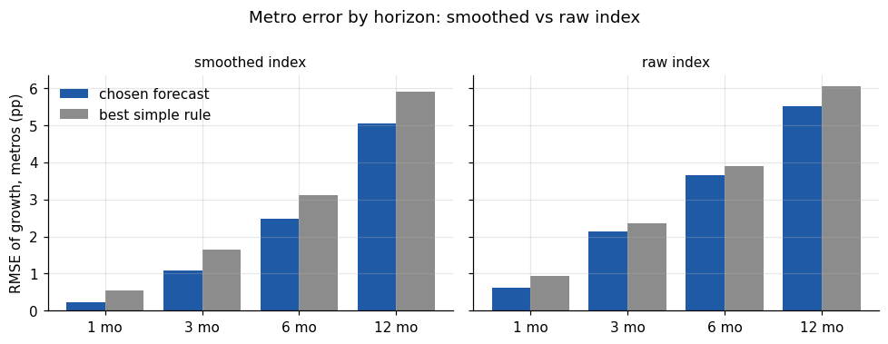
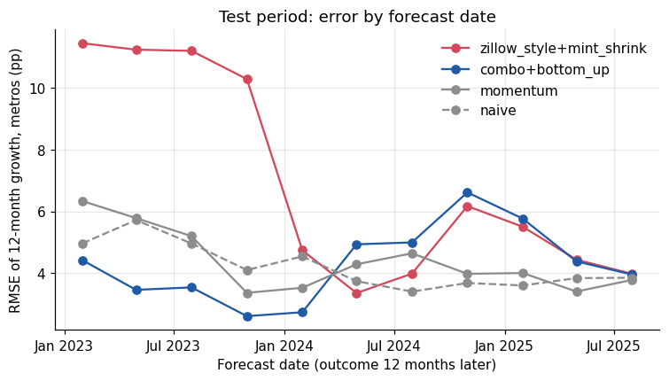
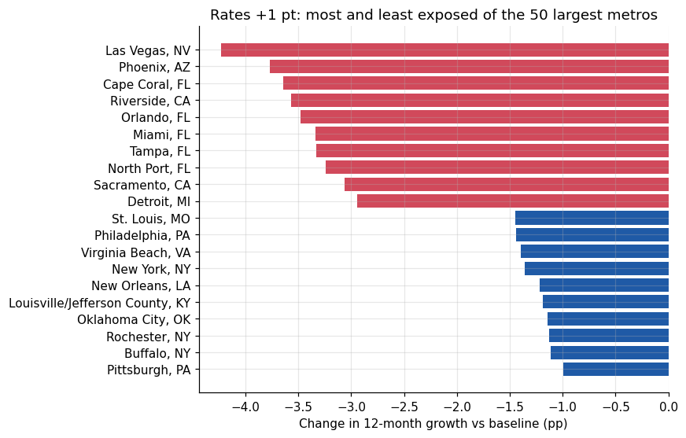
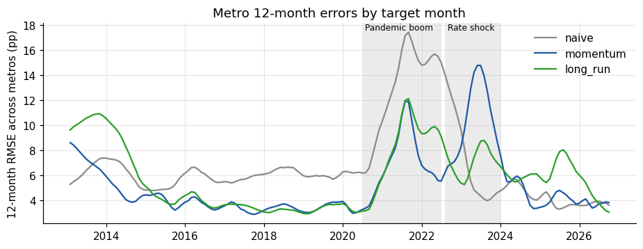

# Full results

The README's detail: data, approach, every result and its limits. CI checks the numbers here and in the
README against `reports/metrics/` (`tests/test_reported_numbers.py`). The [decision memo](../reports/decision_memo.md)
turns them into a recommendation; [PHASES.md](PHASES.md) tells how the project was built.

**Why it is not just "forecast each series".**
* **Forecasts must add up.** A lender or insurer that plans by county but reports by state needs
  county forecasts that sum to the state forecast. Forecasting each level on its own does not give
  that; *reconciliation* does. Here the simplest version, adding counties up, proved as
  accurate as the MinTrace variants at metro and county level.
* **Zillow's index is an average, not a total.** ZHVI is a value-weighted mean, so county values do not
  sum to a metro value. This project forecasts the *value of the housing stock* (ZHVI x housing
  units) instead, which does add up, and converts back to a typical home value at the end.
* **There is an external yardstick.** Zillow publishes the accuracy of its own metro forecast
  (RMSE of monthly growth at 1, 3 and 6 months), so the backtest can be compared with it.

## Data (all public, free)

| Source | Used for |
|---|---|
| [Zillow Research](https://www.zillow.com/research/data/): ZHVI by county, metro, state, nation (middle tier, smoothed, seasonally adjusted); ZHVF forecast | target; Zillow's published series and forecast as benchmarks |
| Census Population Estimates, Vintage 2025 | county housing units (weights), population and net domestic migration |
| FRED | 30-year mortgage rate, US and state unemployment, CPI |

Raw files are not committed. `scripts/download_data.py` fetches them and records URL, date and
SHA-256 in `data/raw/manifest.json`. Data from Zillow is used with attribution.

## Approach

```
download ─> county panel (balanced from 2008) ─> hierarchy: US > state / metro > county (grouped)
        ─> base forecasts (baselines, ARIMA, panel regression, Zillow-style, combination)
        ─> reconcile (bottom-up, 3 MinTrace variants) ─> rolling-origin backtest at 1/3/6/12 months
        ─> forecast from today + rate scenarios x metro exposure ─> decision memo
```

| Stage | Notebook | Status |
|---|---|---|
| Data audit and coherence check | [01](../notebooks/01_data_audit.ipynb) | done |
| Baselines and backtest harness | [02](../notebooks/02_baselines_backtest.ipynb) | done |
| Models and reconciliation | [03](../notebooks/03_models_reconciliation.ipynb) | done |
| Forecast from today and scenarios | [04](../notebooks/04_scenarios.ipynb) | done |
| Final test on later data; Prophet, ETS, ARIMA | [05](../notebooks/05_final_test.ipynb) | done |
| Robustness on the raw index | [06](../notebooks/06_raw_index.ipynb) | done |

## Results

**Recommendation** ([memo](../reports/decision_memo.md)): treat a rise in mortgage rates as the main
12-month risk and tighten limits in the ten most rate-sensitive large metros. A sudden 1-point rise
lowers national 12-month growth by 0.8 to 2.1 pp ($0.45 to $1.2 trillion of housing value), and hits
high-beta Sun Belt metros about four times as hard as Rust Belt and Northeast ones (Las Vegas -4.2 pp,
Phoenix -3.8 pp, Pittsburgh -1.0 pp).

**Accuracy.** RMSE of 12-month growth over 47 quarterly forecast dates, 2014-2025:

| Level | Chosen forecast | Momentum | No change |
|---|---|---|---|
| Nation | 4.3 pp | 5.3 pp | 7.0 pp |
| States | 4.7 pp | 5.6 pp | 7.4 pp |
| Metros | 5.1 pp | 5.9 pp | 7.8 pp |
| Counties | 5.2 pp | 6.1 pp | 7.9 pp |

* **The panel.** 1,371 counties with a full monthly history since 2008 hold 84% of US homes and roll up to
  49 states and 605 metro groups. Rebuilt multi-county metros track Zillow's published growth closely
  (median 12-month growth RMSE 0.29 pp).
* **The bar to beat.** Of four no-model rules, *momentum* (the last 12 months' growth continues) is
  best: metro 12-month RMSE 5.9 pp vs 7.6 pp for "no change". It fails at turning points: 10.7 pp in
  the 2022-23 rate shock.
* **The chosen forecast.** The equal-weight average of a per-place ARIMA(2,1,0) and a rates-aware
  direct panel regression, made coherent bottom-up. Its metro 12-month error is 14% below momentum overall.
  In the 2022-23 rate shock it falls from 10.6 to 6.0 pp, 44% lower. In the 2020-22 boom it was slightly
  worse (8.0 vs 7.4 pp).
* **Reconciliation.** Coherence costs almost nothing with bottom-up or variance-weighted MinTrace.
  MinTrace weighted only by tree shape (wls_struct) fails badly in dollar terms. Full-covariance
  MinTrace helps weak base models but adds noise to strong ones.
* **Uncertainty.** Time-safe conformal ranges are too narrow: nominal 80% ranges cover 73% of metro
  outcomes at 12 months, because misses bunch up at turning points.
* **The outlook from September 2026.** About 3% national growth over 12 months (3.2%), against
  Zillow's 1.1%. The two rank metros alike (correlation 0.79 across 439 metros), but this model sits a
  median 1.2 pp higher. The memo takes the level from Zillow and the ranking and stress from this model.

**The final test: choose on 2014-2021, score once on 2023-2025.** The rules were written down before
any test score was computed ([plan](final_test_plan.md)). The same selection rule, applied to the 32
selection dates alone, picks zillow_style+mint_shrink. On the 11 test dates its metro 12-month error is
7.6 pp against momentum's 4.5 pp, better on only 2 of 11 dates: **it fails**. No candidate passes. The best
on the test dates is the no-change forecast (4.3 pp); combo+bottom_up ties momentum (4.5 pp, better on
5 of 11). At 1-3 months the reconciled forecasts stay well ahead at every level.

* *Why.* Averaged over horizons, the 2014-21 rule rewards trend-following in calm years. After the 2022
  turn the trend-follower broke worst. The 12-month gain in the full backtest comes mostly from the
  2022 forecast dates, which this test leaves out on purpose.
* *What changes.* The 12-month claim is narrowed to the full backtest and the 2022 shock. Damped ETS
  joins the candidates (not declared the winner: it was added after this test was seen). Forecasts
  from September 2026 for every method are saved once and scored as new months arrive.

**Challengers** (nation, 49 states and the 50 largest metros; 50 largest metros shown, 12 months, 2023-25):

| Method | RMSE | Test dates better than momentum (of 11) |
|---|---|---|
| AutoETS (damped trend for almost every series) | 3.4 pp | 10 |
| No change | 3.9 pp | 7 |
| Momentum | 4.6 pp | - |
| combo+bottom_up (this project) | 4.9 pp | 4 |
| AutoARIMA | 5.1 pp | 5 |
| Prophet, tuned on 2014-2021 | 6.3 pp | 1 |
| Prophet, default settings | 13.5 pp | 0 |

Prophet's default trend may only bend in the first 80% of the history, so in 2023 it carried the
2020-22 boom forward. A later bend point, chosen on 2014-2021 only, halves its error, but its forecast
still starts from its fitted trend rather than the latest value.

**How sure.** The independent unit is the forecast date (every metro at a date shares the same shock,
and 12-month outcomes from quarterly dates overlap), so the chosen forecast and momentum are compared date
by date with a Diebold-Mariano test and a block-bootstrap interval for the skill. For metros over all 47
dates: 60% below momentum at 1 month (95% interval 52 to 67%), 35% at 3 months (23 to 45%), 14% at 12
months (-4% to +33%, Diebold-Mariano p = 0.31). On 2023-2025 alone the 1- and 3-month gains hold (63% and
29%); the 12-month difference is nil.



**Robustness: the raw index.** Zillow's headline index is smoothed and seasonally adjusted, so part of
next month is already in this month's value. Rebuilt from the raw index (same 1,371 counties and weights;
its monthly growth swings about 1.2 pp between the best and worst months of the year) and with every model
refitted, the metro error is 32% below the best simple rule at 1 month (95% interval 25 to 39%), against
60% on the smoothed index. At 3 months the gain falls to 10% below a seasonal-naive rule (-5% to +21%),
and at 12 months it is 9%, neither distinguishable from chance. So for actual prices the defensible edge
is the next month.









## Limitations (more in the [model card](../MODEL_CARD.md))
* **On the raw index only the 1-month edge holds** (notebook 06); the 3-month gain on the smoothed index
  comes mostly from the smoothing.
* **The 12-month edge is not proven out of sample.** On 2023-2025 no candidate beats "no change" a year
  out. The test period was not used to choose, but it was seen while the models were designed (for
  example, the rate inputs); only the forecasts frozen in September 2026 are truly unseen.
* **The rate response depends on one episode.** Refitted without 2020-21, the 1-point shock falls from
  -2.1 to -0.8 pp, so the range is quoted. The model cannot represent a 2008-style recession.
* **Revised history.** Zillow restates ZHVI history (e.g. the January 2023 neural-Zestimate
  upgrade), so backtests use today's series, not what was known at each forecast date.
* **No historical Zillow forecasts.** Only the current ZHVF vintage is public, so the comparison with
  Zillow's own forecast is against its *published accuracy*, plus a forward check of today's vintage.
* **Fixed weights.** Housing units are held at the latest Census year, so node totals move with prices,
  not construction.

